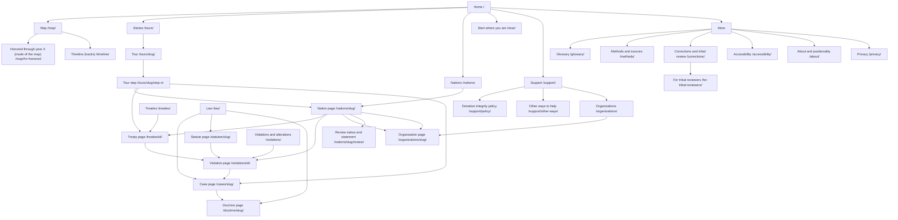

# I2. Information Architecture

**Design Agent I, Treaty Land Atlas.** Working product title: "What Was Promised" (see I1; placeholder "Treaty Land Atlas" in paths and repo until the name is settled). Read with I1 (principles), I3 (interaction), I5 (page structures), J1 (Astro, Svelte islands, Pagefind, base-path helper, `/es/` routing).

**Tags.** `[verified]` = stated in a research or design file in this repo; `[from-memory]`, `[disputed]`, `[unverified]` as usual. **Recommendation** = design choice made here.

---

## 1. Shape of the site

Three kinds of pages, and one rule.

1. **Record pages** are static HTML generated at build time from the data: one per treaty, nation, violation, case, statute, doctrine, organization, glossary term. They work without JavaScript, can be printed, are indexed by Pagefind, and are the permanent citable layer.
2. **The map app** is one interactive page (`/map/`) built as a Svelte island (J1 ADR-002). It is a way of moving through the record pages, not a separate source of truth. Every state of the map has a text or table equivalent (WCAG 2.2 AA; J1 ADR-012).
3. **Stories** are guided tours (`/tours/`) that move through record pages and map states in a fixed order, each ending in the present.
4. **The rule:** *no page may exist only inside the map.* If a thing can be selected on the map, it has a permalink page with sources, an as-of date, and a correction link.

The architecture is therefore a graph of record pages (the graph contract is `docs/design/schema/*.schema.json`, adopted per J1 ADR-007) with three ways to enter it: by place or nation, by theme, and by tour.

---

## 2. Site map

### 2.1 Mermaid diagram

### 2.2 Nodes in plain terms

| Section | Purpose | Page type | Built from |
|---|---|---|---|
| Home | One question, one map teaser, one present-day element, three entry points | Static plus small island | Editorial |
| **Map** | Time slider, layers, detail drawer, Honored mode, Support panel (I3) | Interactive island | GeoJSON, `timeline-events.json`, instrument table |
| Timeline | The four tracks as an accessible list, same data as the slider | Static (island optional) | `timeline-events.json` |
| **Honored through year X** | Counterfactual explorer. A mode of the map, plus a static explainer page | Mode plus static | Instrument table, G2 rules, Legal status taxonomy |
| Treaties | Index with filters (nation, year, ratification status, region), and the unratified list | Static plus filter island | Seed treaty tables (TLA-T-###, TLA-U-*) |
| Treaty page | One instrument: three dates, parties, text link, ratification, what it recognized, what followed, today | Static | `TLA-T-###`, `TLA-U-*` |
| Nations | Index by endonym, with the legal-context labels (federally recognized, state-recognized, Alaska Native corporation distinctions, Hawaii) shown as distinct contexts | Static | Nation entities |
| Nation page | The nation today first, then the four strands | Static | Nation entity, instruments, events |
| Violations and alterations | Index grouped by B1 family; each entry shows its evidence flag | Static | `violation_id` (V001 to V062 in seed) |
| Violation page | One alteration or violation, vocabulary-controlled | Static | B1 data model |
| Law | Cases, statutes, doctrines (C3 knowledge graph) | Static | Case, Statute, Doctrine entities |
| Case page | Holding in plain language, what it did and did not decide, links to affected nations and instruments | Static | C3 `case-*` ids |
| Organizations | F2 directory with Land Back organizations, grouped by F4 tier and type | Static plus filter island | Organization seeds |
| Support | Support flows (below), policy, other ways to help | Static plus map panel | F4 |
| Tours | Nine guided tours (below) | Static steps plus island | G4 tour data model |
| Glossary | D4, four groups (land status; jurisdiction and legal categories; recognition; policy and process) | Static | D4 |
| Methods and sources | How shapes, dates, flags and statuses are made | Static | G2, B1, E2 |
| Corrections and tribal review | How to correct, annotate, withdraw; corrections log | Static | G3 |
| Accessibility statement | Standard, known gaps, contact | Static | J1 ADR-012 |
| About | Who maintains this, positionality, funding, attribution | Static | G3 |
| Near (Start where you are) | County-level place lookup (no address) | Static fallback plus small island | Place index |

### 2.3 Primary navigation (mobile first)

Five items, in a bottom bar on a phone and a top bar on desktop. **Recommendation.**

1. **Map**
2. **Stories** (tours)
3. **Nations**
4. **Support**
5. **More** (glossary, methods and sources, corrections and tribal review, accessibility, about, privacy)

Search (Pagefind) is a field at the top of Nations and of More, not a sixth tab. "Start where you are" is a button on Home and on the Map's empty state. "Corrections" is also reachable from the footer of every page and from every detail drawer.

---

## 3. Static URL structure

Hosting is GitHub Pages with Astro static output (J1 ADR-001). All internal links go through a single `href()` helper using `import.meta.env.BASE_URL` so the site works at `user.github.io/repo/` and on a custom domain (J1 ADR-001). Paths below are shown relative to that base.

### 3.1 URL table

| Pattern | Example | Notes |
|---|---|---|
| `/` | | Home |
| `/map/` | `/map/#y=1868&v=record&l=cessions,today&c=44.5,-103.1,5&sel=...` | One page; state in the hash; no server needed. Keys below |
| `/timeline/` | | Four tracks as lists |
| `/honored/` | | Static explainer and entry to the mode |
| `/near/` | `/near/#state=...&county=...` | County-level only. Static per-state fallback `/near/<state>/` |
| `/treaties/` | | Index and filters |
| `/treaties/<id>/` | `/treaties/tla-t-nnn/`, `/treaties/tla-u-nnn/` | Lowercased stable ID. The title carries the name. IDs are stable, names are not |
| `/nations/` | | Index by endonym |
| `/nations/<slug>/` | `/nations/<ascii-folded-endonym>/` | ASCII-folded slug; display name is never folded (J1 ADR-013). Slug changes keep the old path as a tiny static page that links to the new one (no server redirects on Pages) |
| `/nations/<slug>/review/` | | Review status, history, nation statement, change log for that nation |
| `/violations/` | | Index by B1 family |
| `/violations/<id>/` | `/violations/v001/` | Seed ids V001 to V062 `[verified]` |
| `/law/` | | Index of cases, statutes and doctrines |
| `/cases/<slug>/` | `/cases/johnson-v-mintosh-1823/` | Slug follows C3 id `case-johnson-v-mintosh-1823` without the prefix |
| `/statutes/<slug>/` | `/statutes/<c3-stat-id-without-prefix>/` | C3 ids `stat-...` |
| `/doctrine/<slug>/` | | C3 doctrine layers |
| `/organizations/` | | Directory |
| `/organizations/<slug>/` | | Always shows the F4 label block and tier |
| `/support/` | | Support flows |
| `/support/policy/` | | Full donation integrity policy (F4) |
| `/support/other-ways/` | | Voluntary rent, land tax, advocacy, learning (F4) |
| `/tours/` | | Nine tours |
| `/tours/<slug>/` | `/tours/fort-laramie-and-the-black-hills/` | Overview, content warning, review status, "What we don't know" |
| `/tours/<slug>/step-<n>/` | | One static page per step; the map variant opens in `/map/` |
| `/glossary/` | `/glossary/#cession` | One page, anchor per term; D4 groups |
| `/methods/` | | Overview |
| `/methods/sources/` | | Source list and licences |
| `/methods/uncertainty/` | | Tiers T1 to T4, hatching, why shapes are approximate |
| `/methods/honored-through/` | | The stop-the-clock rule, cut-points, what is and is not modeled |
| `/methods/legal-status/` | | S1 to S9, reviewer name and role, sign-off date |
| `/methods/data/` | | Downloads with lineage and licence |
| `/corrections/` | | How to correct; public corrections log |
| `/for-tribal-reviewers/` | | What review means, what we ask, what we do not do |
| `/accessibility/` | | Statement |
| `/about/` | | Maintainers, positionality (G3), attribution |
| `/privacy/` | | No analytics; only basemap host contacted (J1 ADR-014) |
| `/es/...` | `/es/nations/<slug>/` | Mirror, Spanish first (J1 ADR-013). English has no prefix |
| `/data/*.json` | | Static artifacts for the map and for download |
| `/404.html` | | Helpful not-found (I5 microcopy) |

### 3.2 Map hash keys

Aligned with J1 ADR-006 (`#y=1868&m=cum&l=cessions,today&c=44.5,-103.1,5&sel=TLA-T-300`), with two additions. Updated by `history.replaceState`, debounced; no tracking. **Recommendation.**

| Key | Meaning | Values |
|---|---|---|
| `y` | Year | integer 1778 to 2026 |
| `m` | Time mode (ADR-006) | `cum`, `win`, `evt` |
| `v` | View | `record` (default), `honored` |
| `lens` | Lens (G2) | `fed` (default), `ev`, `tr` |
| `l` | Layers on | comma list of layer ids |
| `c` | Center and zoom | `lat,lng,z` (zoom clamped; see I3) |
| `sel` | Selected feature | stable id |
| `tab` | Drawer tab | `overview`, `evidence`, `legal`, `support` |
| `tour` | Active tour and step | `slug:n` |

The prototype (`prototype/index.html`) writes `y`, `v`, `sel`, `on` and `off` (layers changed from default). In production, `l` replaces `on`/`off`; this is a known difference.

### 3.3 Stable identifiers

IDs are permanent. Names, slugs and spellings can change; IDs cannot. `TLA-T-###` ratified treaty, `TLA-U-*` unratified, `TLA-S-*` statute, `TLA-A-*` agreement `[verified]` (research brief). Case ids follow C3 (`case-johnson-v-mintosh-1823`). Violations `V001`+. Nation ids come from the entity schema (`nat-...`).

### 3.4 Tombstones and withdrawals

When a nation withdraws content (G3), the URL stays and serves a tombstone: "Content on this page was withdrawn at the request of [Nation] on [date]." with `noindex`. If the nation asks for no tombstone, the page serves a generic minimal not-found and the path remains reserved. The data pipeline blocks regeneration of withdrawn content (release gate, J4).

---

## 4. Page gating by tribal-review status

Principle 7 (I1). The status is part of the page's data, not decoration. **Recommendation**, built on G3's statuses.

| Status | Class P and D content (public records; derived geometry and models) | Narrative content and Class K (project-written text about a nation's culture, meaning, priorities or present-day programs; and any Indigenous knowledge or account) | Support suggestions |
|---|---|---|---|
| Not yet contacted | Published, with "not yet reviewed by this nation" | Not published. A placeholder invites review | Tier 1 and 2 organizations only if independently vetted per F4; page says the nation has not been consulted |
| Invited | Same | Not published | Same |
| Edits requested, in progress | Published with a "under revision" flag | Held as before | Same |
| Reviewed by [office], [date] | Published | Published only if reviewed and the review is cited; label states review is not endorsement | As F4 allows |
| Co-authored with [office] | Published | Nation-authored sections attributed and in the tribal-statement voice | As F4 allows; "Nation consulted" can be set |
| Declined to participate | Instrument and sources only | None | Not shown on this nation's page |
| Content withdrawn | Tombstone | Tombstone | Not shown |

A nation page must render a badge at the top (I5 s.4) and one line of explanation. The build fails if a page with narrative content has a status of Not yet contacted, Invited or Declined, or any Class K item without a recorded permission, or any Class S item at all (release gates; add to J4).

The classes are G3 s.2's data classification `[verified]`: P (public federal and state records), D (derived geometry and models), N (names and identifications), K (Indigenous knowledge and accounts, only with documented permission from the community's authorized body), S (sensitive: never published), R (reused third-party datasets). Class N names are published with the best available name, marked unreviewed until the nation confirms. "Narrative content" in the table is the design term for project-written prose that characterizes a nation; G3 s.5 forbids it from speaking for the nation, so it is held until review.

---

## 5. Entry points

Four ways in, per G4. Each lands in a record page or in the map in a defined state.

| Entry | Gesture | Lands on |
|---|---|---|
| **Nation** | Nations index, search | Nation page; Today and Legal status first; button "See on the map" opens `/map/#sel=<nat>&y=2026` |
| **Place** | "Start where you are": choose state and county; no address, no geolocation prompt | `/near/` result: the nations whose treaty records touch that county, with uncertainty wording; link to each nation page and to the map centered at county level |
| **Theme** | Law (cases, statutes, doctrine), Violations by family, glossary | Index pages that cross-link to nations and treaties |
| **Tour** | Stories | Tour overview with content warning and review status, then steps |

"Place" is county-level only: no parcel or address output (G2, G3), and the map clamps zoom (I3 s.8).

---

## 6. Guided tours

Nine tours from G4 `[verified: tour list and titles as in G4 s.4; contents are G4's proposals]`. Each page set follows the tour data model (G4 s.5): ordered steps, each step pointing to a record page and a map state, with required fields. Every tour must have at least one resistance beat and one continuity or return beat, end in the present, carry a content warning, show a tribal-review status, and include a "What we don't know" note. If any of these is missing, the tour does not publish.

| # | Slug | Title (G4) | Anchor records | Review sensitivity |
|---|---|---|---|---|
| A | `fort-laramie-and-the-black-hills` | Follow one treaty: Fort Laramie (1851 and 1868) and the Black Hills | Treaties 1851, 1868; the Black Hills litigation line; Lakota nations | High: sacred geography; narrative content needs review |
| B | `klamath-and-blue-creek` | Follow one river: the Klamath (pilot) | Klamath basin nations; Yurok Blue Creek return | High |
| C | `johnson-to-mcgirt` | Follow one court case: *Johnson v. M'Intosh* to *McGirt* | Case pages; doctrine layers (C3) | Medium: law content, nations affected by McGirt need review |
| D | `cherokee-nation-250-years` | Follow one nation across 250 years: the Cherokee Nation (pilot) | Cherokee instruments, removal, litigation, present | High: pilot nation; propose as the review model |
| E | `blue-lake-taos-pueblo` | Follow one place: Blue Lake (Taos Pueblo) | The 1970 return statute `[from-memory; verify in G4]` | High: sacred place; no location data beyond what the nation publishes |
| F | `a-right-that-still-works` | Follow one right: a treaty clause that still works | Fishing and *Herrera v. Wyoming* line | Medium |
| G | `the-morrill-act` | Follow one dollar and one acre: the Morrill Act | Land-grab universities; Morrill Act statute page | Medium |
| H | `the-word-cession` | Follow one word: "cession" | Glossary; Royce; treaty texts | Low |
| I | `start-where-you-are` | Start where you are | County lookup; nearest nations | Medium |

**Tour page elements** (I5 gives the copy structure): content warning with an opt-in "skip sensitive steps" control; time estimate; review status badge; teacher mode (discussion prompts, printable text); step list; "What we don't know"; "Where this ends: today"; Support step tied to the tour's nation or region.

**Entry from the map.** The map's empty state offers three tours and "Start where you are". Selecting a nation in the drawer offers "Tours that include this nation".

---

## 7. Support flows

The site collects no money (F4). A support flow is always: **understand, then choose, then leave to the organization's own page.**

1. **Entry points:** (a) the Support panel in the map drawer, scoped to the selected nation or region; (b) a nation page's Support section; (c) a tour's final step; (d) `/support/`.
2. **Scoping rule:** the panel shows organizations related to the *selected nation or region* first. It never shows a generic national list as if it were that nation's. If none is vetted, it shows "Ask first", "Other ways to help", and the nation's own official website.
3. **Tiers (F4):** Tier 1 list; Tier 2 list with caveats; Tier 3 information only, no donate link; Do not link. Tier 3 and Do not link organizations may be named in the directory only for information.
4. **Recipient type labels** (F4): Tribal government; Tribal nonprofit; Indigenous-led nonprofit; Fiscally sponsored project (sponsor named); Allied organization (not Indigenous-led). "A gift to an ally is not a gift to a tribe."
5. **Label block** on every listing (F4): Name; Type; Leadership; Registry or EIN; Gift goes to; Designated gift; Nation consulted; Last verified by or evidence; Caveats.
6. **Legal-context separation:** Hawaii (state programs) and Alaska (Alaska Native corporations are for-profit corporations) are labeled as distinct legal contexts and are not shown in a "Tribal government" list (F4).
7. **No-go list:** no "adopt an acre", no leaderboards, no outcome promises, no poverty imagery, no nation seals, no commission, no affiliate links.
8. **Delist triggers** (F4): the page links to the policy; an organization that hits a trigger moves to Do not link and the change appears in the corrections log.

---

## 8. Corrections and tribal review

`/corrections/` is a first-class section, not a footer.

- **Who can use it:** anyone. Tribal reviewers get a dedicated page.
- **How:** a form (mailto or private issue; no public thread for a nation's correction) with fields: page, what is wrong, source, whether you are writing for a nation or office.
- **What happens:** acknowledgement, review by a maintainer, a legal reviewer for Legal status today, and a published corrections log (date, page, change, who reviewed). A nation's request is applied before any other work on that page unless it conflicts with the public record, in which case the nation's statement is published beside it.
- **Withdrawal:** described plainly, with tombstone behavior.
- **Fix times:** stated once the maintainers can commit (open question in I1).

---

## 9. No-JavaScript and low-bandwidth behavior

`[verified as requirements: G3 s.11, J1 ADR-012 and ADR-011]`. Concretely:

| Surface | Without JavaScript | On a slow connection |
|---|---|---|
| Treaty, nation, violation, case, statute, doctrine, organization, glossary | Fully readable; related-item lists replace graph visuals | Text first; no images required |
| Map | A `<noscript>` block explains the map needs script, links to the Timeline, the Treaties index and the Nations index, and offers the table of every feature for a chosen year | Core budget about 3 MB gzipped (E3, J1 ADR-011); a "Load map shapes now" button before the large file |
| Time slider | Not reproduced as per-year pages (too many); the Timeline page lists events by year and links each to its record page | Same |
| Tours | Every step is a static page | Each step lighter than the map |
| Support | Static labeled list | |

---

## 10. Internationalization

English at launch, Spanish next (J1 ADR-013); `/es/` mirrors the tree. No Indigenous-language UI, audio or machine translation without community authorization (G3). Indigenous-language names appear as the nation provides them, in a `lang`-tagged span. Where the endonym is not yet confirmed, the page shows the best available name with "endonym not yet confirmed" and the historical name "as named in the treaty" (J1 ADR-013).

---

## 11. Content model summary (what each record page is made of)

| Page | Required blocks (all with source and as-of date) |
|---|---|
| Treaty | Today (nation, status), three dates, parties, instrument text link, ratification, what it recognized, what followed (violations/alterations), resistance and law, returns, uncertainty tier, lineage, review badge, correction link |
| Nation | Nation today (endonym, official site), legal context label, review badge, four strands, instruments, support section |
| Violation | B1 vocabulary term and plain label, evidence flag, actor, consent status, instrument, acknowledgment, confidence, sources, tribal review status |
| Case | Plain holding, citation as verified, what it did not decide, affected nations and instruments, doctrine tags, later treatment, as-of date |
| Statute | Citation as verified, effect, scope, affected nations, later amendments |
| Organization | F4 label block, tier, recipient type, last verified, caveats |

The detailed layouts are in I5 s.5.

---

## Open questions

1. Treaty URL form: ID-only paths are stable but unfriendly in a share card. Alternative: ID plus slug with a generated alias page. Choose before launch.
2. Whether the `/near/` county page lists nations whose Royce polygons touch the county, which can overstate or understate the relationship at T3. Needs a methods decision with G2 (suggest wording "records that touch this county", not "whose land this is").
3. Whether tours live under `/tours/` only or also under each nation page; both is recommended.
4. Whether the Timeline needs its own page or only lives inside the map (accessibility argues for its own page).
5. Hash key `lens`, `tour` and `tab` need a final naming review with the engineering owner.

---

## Sources

- `/home/claude/treaty-land-atlas/docs/00-RESEARCH-BRIEF.md`
- `/home/claude/treaty-land-atlas/docs/research/G2-counterfactual-map-methodology.md`
- `/home/claude/treaty-land-atlas/docs/research/G3-ethics-and-indigenous-data-governance.md`
- `/home/claude/treaty-land-atlas/docs/research/G4-pedagogy-and-narrative-arcs.md`
- `/home/claude/treaty-land-atlas/docs/research/F4-donation-integrity-policy.md`
- `/home/claude/treaty-land-atlas/docs/research/B1-violation-typology.md`
- `/home/claude/treaty-land-atlas/docs/research/C3-doctrine-map.md`
- `/home/claude/treaty-land-atlas/docs/research/D4-glossary.md`
- `/home/claude/treaty-land-atlas/docs/data/E3-static-hosting-and-map-tech-feasibility.md`
- `/home/claude/treaty-land-atlas/docs/design/J1-architecture-decision-records.md`

## Confidence & Gaps

**Confidence: medium.** The site tree and URL table follow the stated stack and research. The page-gating rules and the support flow are design recommendations that depend on how G3 and F4 are finally adopted.

**Gaps.**
- Tour contents (steps, sources) are G4 proposals, not verified here; Tour E's statute reference is flagged `[from-memory]`.
- "Narrative content" is this file's design term; G3 does not define it. Confirm the gate rule with the G3 author and the tribal advisors.
- No user testing; the primary navigation is a hypothesis.
- Page counts (about 370 ratified plus about 45 unratified treaties, 575 recognized nations, 62 seed violations) are from the seed data and research; the number of generated pages (about 1,000 per J1) depends on final data.
