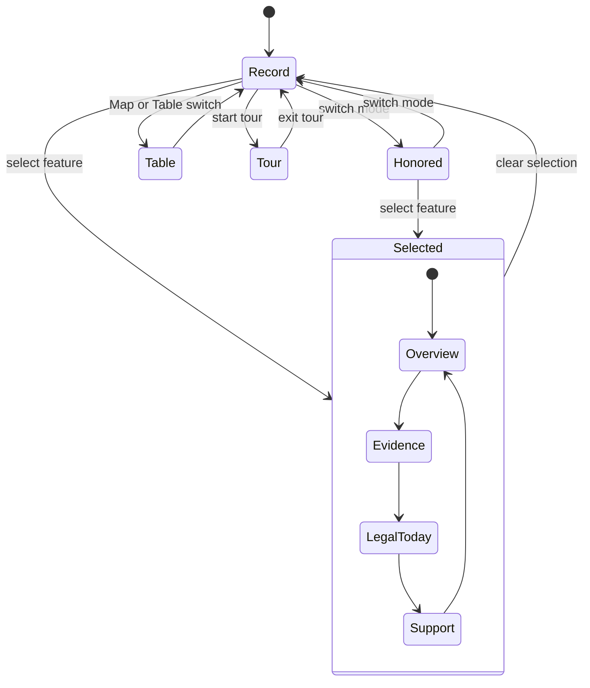
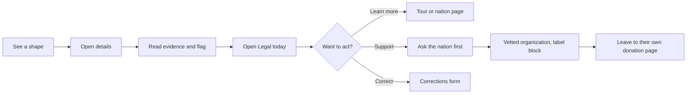
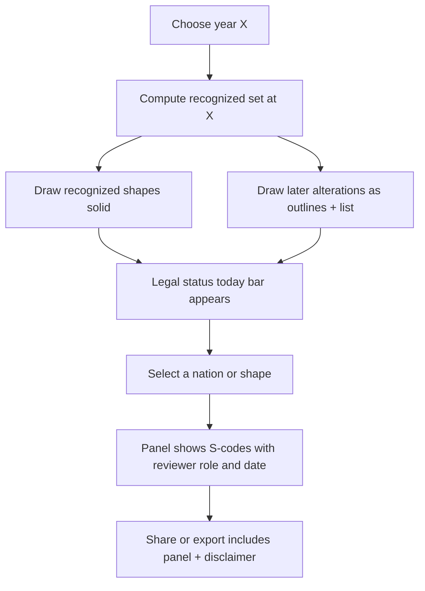

# I3. Interaction Design

**Design Agent I, Treaty Land Atlas.** Working title "What Was Promised". Read with I1 (principles), I2 (IA and URLs), I4 (visual identity and tokens), I5 (copy). Methodology from G2 (layers L0 to L8, stop-the-clock, Legal status today, uncertainty tiers), G3 (voice, review, accessibility), G4 (present-first, four tracks, play mode), F4 (donation policy), B1 (violation vocabulary), J1 (stack and URL hash).

**Tags.** `[verified]` = stated in a research or design file in this repo, or observed in the prototype in this session. `[from-memory]` etc. as usual. **Recommendation** = a decision made here.

**Prototype.** `/home/claude/treaty-land-atlas/docs/design/prototype/index.html` is a single file, no dependencies, mobile-first. All its data is labeled illustrative: "Example Nation A" to "F", no real polygons, no real treaties, EINs that read "00-0000000 (illustrative)". It demonstrates the interactions in this file. It is a wireframe, not the product. It was run in headless Chromium at 390 by 844 and 1280 by 800 in light and dark: no console errors or warnings in the final functional run (slider stops, keyboard, play, hash round trip, table view, dialog) `[verified this session]`.

---

## 1. Screen model

One screen, three regions, in every viewport. **Recommendation.**

| Region | Holds | Mobile | Desktop (900px and up) |
|---|---|---|---|
| **Top bar** | Product name, mode switch (Federal record / Honored through year), layers button, view button (map / table), search | Compact, 56px | Same, with search field |
| **Stage** | The map, zoom controls, legend chips, the disclaimer line | Full width | Center column |
| **Panels** | Layers panel, Detail drawer | Bottom sheets | Left rail (280px), right drawer (384px) |
| **Dock** | Year numerals, play, caption, slider, stops, tracks | Fixed bottom, always visible | Fixed bottom of stage |

The dock is never covered by a sheet. The slider and the "Today" stop are always reachable (principle 1).

### 1.1 Mobile, default state (ASCII)

```
+--------------------------------------+
| What Was Promised   [Record|Honored] |  top bar
| [Layers]            [Map|Table] [?]  |
+--------------------------------------+
|                                      |
|            (map)                     |
|     hatched = recognized             |
|     solid   = reservation            |
|     dashed edge = approximate        |
|                      [+]             |
|                      [-]             |
|                                      |
| Illustrative data. Not a boundary.   |
| Not legal advice. [What this map     |
| is not]                              |
+--------------------------------------+
| Federal record as of        1868     |  dock
| Since 1830: Removal Act     [> Play] |
| |----o------------------------|      |
| [1778][1830][1868][1887][1934]...>   |  stops scroll
| Instruments  . .  .                  |  tracks
| Alterations      .   . .             |
+--------------------------------------+
```

### 1.2 Mobile, feature selected (half sheet)

```
+--------------------------------------+
|            (map, focused on shape)   |
|                                      |
+==[ grab handle ]=====================+
| Example Nation B: allotment    [^][x]|
| Event . 1887                         |
| [Overview][Evidence][Legal][Support] |
| Nation today: Example Nation B       |
| Review: (o) Not yet contacted        |
| Communal land divided into ...       |
+--------------------------------------+
| dock (always visible)                |
+--------------------------------------+
```

Sheet states: `closed`, `peek` (title only), `half`, `full`. The resize button cycles the states; dragging the handle is an enhancement, not the only way (WCAG 2.5.7 dragging alternative; J1 ADR-012).

### 1.3 Desktop

```
+----------+---------------------------------------+-----------------+
| Layers   |  What Was Promised  [Record|Honored]  | Details         |
| [x] Recog|                                       | Example Nation  |
| [x] Resv |             (map)                     | B: allotment    |
| [ ] ICC  |                                       | [Overview]...   |
| [ ] Right|                                       | ...             |
| [x] Alter|                                       |                 |
| [x] Viol |                                       |                 |
| [x] Retrn|-------------------------------------- |                 |
| [x] Today|  1868  > Play  |----o-------| stops   |                 |
+----------+---------------------------------------+-----------------+
```

---

## 2. The time slider

### 2.1 Anatomy

- **Year numerals** (large, tabular figures) with a caption saying what the year means in the current mode: "Federal record as of" or "Documents recognized through" (see s.4).
- **Chapter line:** the last named stop at or before the year: "Since 1830: Removal Act". At a stop the prefix is omitted.
- **Native `<input type="range">`** (J1 ADR-012), min 1778, max 2026, step 1, with `aria-valuetext` that includes the year, the chapter and, in Honored mode, "documents recognized through this year". Off-stop years announce "since 1830, Removal Act" so a screen reader user is not told that 1858 *is* the Removal Act.
- **Stop buttons** (nine; 44px target) that jump to a stop and show it as pressed. The 2026 stop is labeled "Today" and has a heavier outline.
- **Play button** (optional, pausable). Advances stop to stop, one every 3 seconds (`--motion-play-interval`), ends on Today, and pauses itself when the user touches the slider or when focus moves into the drawer. It is off by default and does not start without a gesture (WCAG 2.2.2). With `prefers-reduced-motion`, Play steps without fades.
- **Four tracks** under the slider (G4 s.3.1): Instruments; Alterations and violations; Law and resistance; Returns and restoration. Each event is a link and a dot on the slider's time axis; the same events appear in an HTML list on `/timeline/`.
- **Keyboard:** Left and Right arrows change one year; PageUp and PageDown change ten; `[` and `]` jump to the previous or next stop; Home and End go to 1778 and Today. All verified in the prototype this session `[verified]`.

### 2.2 The nine states

Stops are the prototype's nine, per the brief: 1778, 1830, 1868, 1887, 1934, 1953, 1975, 2020, 2026. Cut-points for the "honored" query (G2: 1783, 1830, 1851, 1868, 1871, 1887) are separate; they are a menu of "stop the clock here" choices in Honored mode (s.4.3). The two lists overlap but are not the same, because the slider is a teaching path and the cut-points are defined by G2 `[from-memory dates: verify against Kappler and the Statutes at Large before publishing]`.

"Record view" shows features whose date range includes the year. "Features shown" counts are what the prototype draws, with six present-day boundary outlines always on, so the figure includes six Today shapes `[verified in headless run]`.

| Year | Stop label (prototype) | What the map shows in the prototype (Record view) | Features | What this state teaches | Production notes |
|---|---|---|---|---|---|
| 1778 | First treaty | One treaty marker with no geometry (T4, icon only), plus present-day outlines | 7 | The beginning of the record is a single instrument, and Today is already visible | The real first treaty record and its parties, with a card instead of a polygon. Date is the effective date, not signing, if they differ (three dates) |
| 1830 | Removal Act | Example Nation A's recognized territory (hatched, dashed soft edge); present-day outlines | 8 | A recognition that documents had made, before the alteration that follows | Real statute is the "Removal Act era"; do not claim a single date applies to every nation. Verify the Act's date |
| 1868 | Fort Laramie era | Recognized territories for Nations B and C overlapping (two hatch directions), B's reservation as set aside, D's reservation (solid, never diminished) and a reserved-rights icon, E and F reservations, and A's 1836 transfer (flagged E1) | 14 | Overlapping claims remain overlapping; a reservation can persist unaltered; rights can have no area | The real Fort Laramie 1851 and 1868 instruments; overlap shown per G2 s.5 with alphabetical claimant list by endonym |
| 1887 | Allotment Act | B's reservation after the 1877 Act, the 1877 taking (E3, E4, E6), the 1887 allotment marker (point only, no parcels) | 14 | Alterations are different kinds of act; allotment is a policy, shown as an event, never as parcels | Allotment events are statute-level or reservation-level, not parcel-level (principle 9) |
| 1934 | Reorganization Act | B's 1889 diminishment (statute), prior alterations still shown, F's 1910 carve-out marker | 16 | Law keeps changing the same land; the "for what purpose" qualifier matters for diminishment | Reorganization Act is a change of policy direction; show it on the Law and resistance track as well as an event |
| 1953 | Termination policy | Adds E's termination marker | 17 | Termination is a different act from treaty abrogation, and was reversed later | Verify every termination act date and restoration act; nations in Alaska and Hawaii treated as distinct contexts |
| 1975 | Self-determination | Adds D's and E's restorations (returns style: dotted wash) | 19 | Returns are first-class, and they begin in the middle of the record, not at the end | Real restorations, with the mechanism and who holds title |
| 2020 | McGirt and recent returns | Adds B's purchased-and-trusted land (2012) and F's transfer (2020) | 21 | Treaties as living law and land coming back by several mechanisms (F1) | Do not imply a boundary is confirmed beyond the cited case; show "as of" dates |
| 2026 | Today | All of the above; present-day outlines, Legal status today one tap away | 21 | The nations are here now, with what the law says now | "As of" date shown for every 2025 and 2026 item (C3) |

(The prototype's 1887 and 1934 states are not the real history; they show *kinds* of events. See the banner on the page.)

### 2.3 After 1894: the slider changes mode

The Royce geometry ends in 1894 `[verified in E3 and J1]`. After that, the map cannot honestly show polygons for alterations. **Recommendation, per J1 ADR-006:**

- Up to 1894 the map is in **Area mode**: cumulative shapes from Royce-derived data, tiered by uncertainty.
- After 1894 the map is in **Event mode**: the Today layer plus event markers and the legal status panel, with a visible banner: "Cession geometry ends in 1894. Later changes are shown as events, not areas."
- The slider track itself changes appearance at 1894 (a marked notch and a label), so the change is visible on the control and not just in the banner.
- The prototype shows this as a hatched segment of the slider track after 1894, a help line ("Hatched track: cession polygons end in 1894") and a caption after 1894 that says what the map shows from then on `[verified in the prototype]`.

### 2.4 Modes: cumulative, window, event snapshot

Per J1 ADR-006: **Cumulative** (default), **Window** (last 1, 5, 10, 25 years), **Event snapshot** (instrument markers only). Window and snapshot sit behind a "Show" menu in the layers panel, not in the top bar, because the default mode answers the main question.

### 2.5 Avoiding the "vanishing" effect

G4 s.3: no frame in which the nation disappears. Therefore:

1. Today outlines are drawn in every frame (they can be hidden, with the consequences in s.3.2).
2. Alterations are drawn as outlines or flagged shapes, not as the nation's area shrinking to nothing.
3. A "Nation today: [endonym]" line is in every popup and drawer.
4. Play ends on Today and does not loop.

---

## 3. Layers panel

### 3.1 The list

Sheet on mobile, rail on desktop. Eight toggles that map to G2's layers. L0 (basemap) is always on; L1 (instruments as signed) is exposed through selection, not a toggle; L7 (land-status context, coarse and opt-in) is not in the prototype and is listed under open questions.

| Toggle (label) | G2 layer | Default | Encoding | Not color-only because |
|---|---|---|---|---|
| Treaty-recognized territory | L2 (stop-the-clock result) | On | Hatched fill, diagonal; edge dashed when the boundary rests on landmarks (T3) | Hatch direction and dash style carry the meaning |
| Reservations as set aside | L1/L2 | On | Solid wash with a solid edge | Solid edge, no hatch |
| Aboriginal title (ICC findings), indicative | L4 | Off | Dotted edge, no fill; label "indicative region, not a boundary" | Dotted edge only |
| Reserved off-reservation rights | L5 | Off | Icon and text; no area | Icon |
| Cessions and other alterations | L3 | On | Wash plus line; also hover list | Outline style, labeled in drawer |
| Violation events | L3 (evidence-flagged) | On | Family-framed icon (B1) | Shape of frame and glyph |
| Returns and restorations | L8 | On | Dotted wash with solid edge | Dot pattern |
| Today: present-day boundaries | L6 | On | Ink outline with a casing | Outline weight |

Each row has: switch (native checkbox), swatch drawn with the actual pattern, one line describing what it is, and an expand control with the fuller description. Hiding a layer is remembered in the URL (`l=`).

**Four legal concepts stay visually distinct** (G2): aboriginal title, treaty-recognized title, reservation, reserved off-reservation rights. No two share a fill. The legend repeats this with one sentence each, linking to the glossary entries.

### 3.2 Hiding Today

Today can be hidden (some readers want a cleaner map), but L6 must remain one click away (G2, G4). When it is hidden, a persistent chip in the stage reads "Today is hidden. Show", and Honored mode refuses to hide it. **Recommendation.** `[the prototype implements the chip; the Honored-mode restriction is a requirement not yet built in the prototype]`

### 3.3 Uncertainty and overlap legend

Always visible in the panel footer, collapsed to one line on mobile: "Edges are soft where boundaries rest on landmarks. Hatching means more than one nation's documented claim. This map does not adjudicate between nations." (I5 s.6.2.)

### 3.4 Filters

Nation (alphabetical by endonym), instrument type (ratified, unratified, executive order, statute), violation family (B1: Acts of Congress, Treaty-making and performance, Takings, Context), evidence flag (E0 to E7), return mechanism (F1). Filters are inside the panel under "Narrow down", closed by default. A filter never changes a shape; it only hides features, and a count line says how many are hidden.

### 3.5 Lenses

Federal-record (default), Evidence-flag, Tribal-account (G2). Switching lens changes labels and emphasis, never the geometry. Tribal-account lens shows only content the nation has supplied or reviewed; when none exists it says so. **Recommendation.**

---

## 4. Counterfactual explorer: "Honored through year X"

### 4.1 What it is and is not

A stop-the-clock query (G2 s.2(b)): *what had the United States already promised, by year X, that had not yet been altered?* It is not a claim about what should happen now, not a statement about who owns land today, and not a map of "what was stolen". It avoids deciding legitimacy `[verified]` (G2).

### 4.2 Entering the mode

Mode switch in the top bar: **Federal record** / **Honored through year**. In Honored mode:

1. The caption changes to "Documents recognized through" and the year numerals gain a text label "A model".
2. Recognized territory and reservations in effect at X draw solid. Alterations after X draw as outlines with a lighter fill ("later changes are outlines only") and are listed, each with its category and evidence flag.
3. The **Legal status today bar** appears above the dock and cannot be dismissed. Its summary updates with the selection ("Select a shape to see its status. Status differs by nation." when none).
4. A first-use notice explains the mode in four sentences (I5 s.6.3).
5. The mode writes `v=honored` to the URL.

### 4.3 Choosing X

- The slider, as usual.
- A **cut-point menu** next to the year: 1783, 1830, 1851, 1868, 1871, 1887 (G2). Each carries a short description. Cut-point dates are `[from-memory]` until verified against Kappler and the Statutes at Large, and the menu is not shown in production until they are.
- Choosing a year in Honored mode never changes the underlying record; it only changes what is counted as "recognized."

### 4.4 Voluntary versus duress

G2 s.2(b)-ii warns that treating all later transfers as excluded erases tribal agency and flattens negotiated sales and coerced takings. **Recommendation:** every alteration shape after X carries a consent line in the drawer: evidence flag (E0 to E7), signatory authority if contested, and the nation's own account if reviewed. The map legend for alterations says "agreed, contested, or imposed: open the shape to see the evidence." No red.

### 4.5 The mandatory "Legal status today" panel

**Rule (G2 s.7):** a Legal status today panel appears on every counterfactual view, even when collapsed. The prototype implements this as a persistent bar and a drawer tab. In production it also appears on every shared image from Honored mode and on every printed page.

Taxonomy `[verified as fixed in G2 s.7]`:

| Code | Label |
|---|---|
| S1 | Reservation boundaries intact |
| S2 | Diminished |
| S3 | Disestablished or terminated |
| S4 | Aboriginal title extinguished with ICC payment |
| S5 | Compensable taking recognized, land not returned |
| S6 | Equitable bars to regaining sovereignty over reacquired land |
| S7 | Treaty rights currently enforceable |
| S8 | Restored or returned by statute or purchase |
| S9 | Under litigation or negotiation (date stamp required) |

**Panel structure (wireframe):**

```
+--------------------------------------------------------------+
| Legal status today                              as of [date]  |
| Example Nation B                                              |
+--------------------------------------------------------------+
| (S2) Diminished                                               |
|   For what purpose: federal criminal jurisdiction (Solem      |
|   framework). A different question from who owns the land.    |
| (S5) Compensable taking recognized, land not returned         |
|   A court found a taking; the remedy was money.               |
+--------------------------------------------------------------+
| What the treaty said:        [quote with cite]                |
| What happened:               [events, linked]                 |
| What the courts decided:     [cases, linked, with pin-cites]  |
| What this means today:       [one plain sentence]             |
+--------------------------------------------------------------+
| Not both directions? Treaty rights also still work: (S7) ...  |
+--------------------------------------------------------------+
| Reviewed by: [role], signed off [date]   [Report an error]    |
| This panel summarizes legal history for education. It is not  |
| legal advice and is not a statement about any current claim.  |
+--------------------------------------------------------------+
```

Rules, all from G2 s.7 and C3:

1. Multiple statuses can apply, shown together. Not a single verdict.
2. "For what purpose" is mandatory for S2 and S3 (diminishment and disestablishment are about jurisdiction, B1 label rule).
3. The line "this does not mean nothing can be done" is not written as such; instead, show both directions, advances and erosions, with dated items (C3). The panel always includes at least one "advanced" and one "eroded" item where both exist, or says there are none recorded.
4. "Would have" and "as described" language, never "rightfully" (I5).
5. Reviewer role and sign-off date are mandatory fields; the build fails if empty (add to J4 release gates).
6. S9 items carry an "as of" date and are hidden after a staleness threshold unless refreshed.
7. If no status has been assigned for a shape, the panel says "No status has been assigned yet" and does not guess.

### 4.6 Exiting

The mode switch returns to Federal record. The drawer remembers its tab. The URL updates.

---

## 5. Detail drawer

Opens on selection (click, tap, Enter on a focused marker, or choosing a row in the table view). It is a labeled region (`role="complementary"` on desktop; a modal-free bottom sheet on mobile that does not trap focus but returns focus to the originating control when closed).

### 5.1 Common header

```
Example Nation B: land taken by the 1877 Act        [Resize][Close]
Alteration . 1877 . Evidence: E3 E4 E6
Nation today: Example Nation B    (o) Review: Not yet contacted
```

Elements, in order: title (name as the record gives it, with the endonym when confirmed), type and date (three dates when they differ), evidence flags as chips with plain labels, "Nation today" line (G4 UI string), tribal-review badge (I5 s.4).

### 5.2 Tabs

| Tab | Treaty | Violation or alteration | Case |
|---|---|---|---|
| Overview | Parties, three dates, what it recognized, plain summary, the instrument text link | Plain summary of what happened, the B1 term and its definition, the actor, the nation's account if present | Plain holding, what it decided and did not decide |
| Evidence | Ratification, signatory authority, consent evidence, geometry lineage, tier | Evidence flag explanation, sources, confidence, secondary types | Citation as verified, pin-cites, later treatment |
| Legal today | S-codes that apply, linked to cases | Same | Doctrine tags (C3), nations and instruments affected |
| Support | Organizations for this nation or region (F4) | Same | Same |

Each tab begins with the voice indicator (s.5.4). The drawer's last line is always "Report an error or add a statement" (links to `/corrections/` with the page and feature id pre-filled).

### 5.3 Treaty drawer (wireframe)

```
Treaty with [Nation], [place], [year]                    TLA-T-nnn
Ratified . Effective [proclaimed date]
  Signed [date] . Ratified [date] . Proclaimed [date]
Nation today: [endonym]  (o) Review status
-----------------------------------------------------------------
[Overview][Evidence][Legal today][Support]
What it recognized:  [plain text]  (source)
What followed:       [alterations, linked, with flags]
Geometry:            T3 approximate. Source generalized, 1:2,000,000.
Text of the treaty:  [link to the primary source]
[Open page]  [Show on map]  [Cite]  [Share]
```

### 5.4 Voice blocks in the drawer

G3 requires four voices to be visually distinct. In the drawer each block carries a left marker and a label:

| Voice | Marker | Label text |
|---|---|---|
| Project summary | None (default text) | "Summary by the project" |
| Primary source quotation | Quote bar, serif | "From the document: [citation]" |
| Tribal statement | Distinct frame and a nation seal-free glyph | "Statement by [Nation / office], [date]" |
| Contributed narrative | Dashed frame | "Contributed by [name or role], [date]" |

Never an unlabeled paragraph on a nation page that speaks for the nation.

### 5.5 Violation drawer specifics

- Icon from the B1 family set (frame shape = family), type term in plain words with the B1 code in small print for researchers.
- Label rules (B1): "abrogated" only when a statute or court ended the obligation; "taken" only for recognized title; "diminished" or "disestablished" only for boundaries and with "for purposes of federal criminal jurisdiction" when citing the cases; "terminated" only for 1950s and 1960s acts; "unratified" is not "broken"; "broke" or "failed to honor" for non-performance.
- Context codes (infrastructure siting, federal land disposal, protective designation rollback, annexation) use a dashed frame and the label "Context: not an adjudicated breach."
- For E0 to E2 the header says "Alteration"; for E3 to E7 it may say "Violation," with the reason (G2).
- Content warnings (s.9) appear before the narrative when the event involves killing, forced removal of children, or similar.

### 5.6 Case drawer specifics

Case drawer shows the plain-language holding, a "What this did not decide" line, doctrine chips (C3 tags), and a "Both directions" strip: whether the case advanced or eroded tribal rights, shown as text and icon, never as colors alone. Cases from 2021 to 2026 carry "as of [date]" and a "later developments may apply" notice (C3).

---

## 6. Support panel

### 6.1 Principles

- The site collects no money. Every listing links to the organization's own page (F4).
- Support is scoped to the *selected nation or region*. No selection: the panel explains and offers tours and "Other ways to help".
- "A gift to an ally is not a gift to a tribe." The recipient type is always the first line.
- Most tribal governments do not run public donation programs `[unverified, F4's own generalization]`. Therefore the default advice for any nation is "ask first": the nation's official website and contact, then vetted options.

### 6.2 Layout

```
+--------------------------------------------------------------+
| Support                    For: Example Nation B (selected)   |
+--------------------------------------------------------------+
| This site does not take money. Links go to each organization's |
| own page. [How we choose]                                      |
+--------------------------------------------------------------+
| 1. Start with the nation                                       |
|    Official website of Example Nation B   [Open]               |
|    Many tribal governments do not run public giving programs.  |
|    Ask before you give.                                        |
+--------------------------------------------------------------+
| 2. Organizations                                               |
|  [Tier 1]  Example Tribal Nonprofit of Nation B                |
|    Type: Tribal nonprofit                                      |
|    Leadership: Verified: controlled by the nation              |
|    Registry: EIN 00-0000004 (illustrative)                     |
|    Gift goes to: Example Tribal Nonprofit                      |
|    Designated gift: General support only                       |
|    Nation consulted: [yes/no/unknown]                          |
|    Last verified: 2026-10-16 (evidence)                        |
|    Caveats: ...                                                |
|    [Go to their donation page (leaves this site)]              |
|                                                                |
|  [Tier 2]  ... with caveats shown before the link              |
|  [Tier 3]  ... information only, no donate link                |
+--------------------------------------------------------------+
| 3. Other ways to help (no money)                               |
|    Voluntary rent or land tax programs; advocacy; learning     |
+--------------------------------------------------------------+
| We never take a cut. No tracking of what you click.            |
+--------------------------------------------------------------+
```

### 6.3 Behavior

- Tiers are expressed by words ("Listed", "Listed with caveats", "Information only") and a glyph, not color. Tier 3 has no outbound donate button.
- The label block is not collapsible for Tier 2 caveats; they come before the link.
- Do-not-link organizations never appear here. They appear in the directory with the reason only if the maintainers decide to publish the reason (F4 delist triggers; legal review of any statement about a named organization).
- Alaska Native corporations (for-profit corporations) and Hawaii programs (state programs) are labeled as distinct legal contexts and never presented as "Tribal government."
- Leaving the site: the link opens in the same tab with the visible text "Go to [domain]" and a one-line confirmation on first use. No interstitial that delays the user (dark pattern), no tracking parameters appended.
- Empty state: "We have not verified any giving options for [Nation]. Start with the nation's own website, or see other ways to help." (I5.)
- A "No pressure" principle: no countdown, no thermometer, no urgency, no "your gift will", no comparative claims.

---

## 7. Place lookup and zoom limits

- **Place lookup is county-level only** (G2 s.6): the user picks a state and county from lists; no geocoding, no address field, no geolocation prompt, no echo of an address. The result is a list of nations and instruments associated with the area in cited sources, with wording "records that touch this county," never "your home is on stolen land," never ranking "violations near you."
- **Zoom clamp:** the map will not zoom past a scale of roughly 1:2,000,000 for historical layers (`--mapstyle-historical-max-zoom`: 8). At the limit the shapes stop sharpening and a notice appears: "Historical shapes are generalized from maps at about 1:2,000,000 and cannot show a lot or an address." Present-day (L6) boundaries from federal sources can display at their native generalization, but not at parcel level.
- **No sacred sites:** the map has no mechanism to add or display sacred site locations (G3).

---

## 8. Mobile-first behavior

The owner works from his phone, so the phone is the primary design target, not an adaptation. **Recommendation.**

1. **Thumb zone.** Primary controls (slider, stops, play, layers button) are in the bottom third. The mode switch is top but also available as a segmented control in the layers sheet.
2. **Sheets.** Layers and Details are bottom sheets with four heights. They never cover the dock. Only one sheet is open at a time. Closing returns focus.
3. **Touch targets** 44px minimum (`--size-tap`), 24px minimum for inline controls (WCAG 2.5.8).
4. **Gestures have alternatives.** Pan and pinch zoom are enhancements; zoom buttons and a "Reset view" exist. Slider drag has stop buttons and the numeric keys. Sheet dragging has a resize button.
5. **Stops row scrolls horizontally** with snap, and shows a trailing fade so the next stop is hinted; the current stop scrolls into view.
6. **Selection focuses the map** on the shape and shows the sheet at half height. Overlapping markers fan out so each icon remains tappable `[verified in the prototype]`.
7. **Orientation:** in portrait the map is tall; in landscape the drawer becomes a right rail.
8. **One-handed share:** a Share button in the drawer opens the native share sheet with a text-and-link payload; the image card includes the year, mode, lineage line and disclaimer (G4). No image is generated that lacks the disclaimer.
9. **Performance budget** (J1 ADR-011, E3): about 3 MB gzipped to first interactive map; the large shapes load after the first paint; the table view is available immediately and is the fallback when WebGL fails. Not measured yet on real phones (open question).
10. **Data-saver:** respect `Save-Data`; do not autoplay; defer the basemap behind a "Load map" button on very slow connections.
11. **No hover-only information.** Everything shown on hover is available on focus and tap.
12. **Install and offline:** not in v1. A static offline-readable page set is a later option.

---

## 9. Content warnings and sensitive material

G3 s.10: warnings with a skip option; sensitive tours opt-in.

- The drawer for events involving mass killing, forced removal, boarding schools or similar begins with a one-line warning and a "Skip details" control that collapses the narrative to the neutral facts (date, instrument, source).
- Tours begin with a warning panel: what the tour covers, a list of sensitive steps, "Skip sensitive steps" and "Continue".
- Warning copy is in I5 s.3. No graphic imagery anywhere, no photographs of people without consent and review.
- Warnings do not use alarm colors; they use a plain labeled box with a neutral icon.

---

## 10. Accessibility details specific to the interactive layer

1. **Every map state has a text and table equivalent.** A "Map / Table" switch lists features visible at the current year and layers, sortable, with the same links as the map. The prototype's table view lists the features in view (ten rows at some years) `[verified]`.
2. **Keyboard:** features are focusable in a logical order (by nation, then date). Enter selects. Escape closes the top sheet, then clears the selection. Slider keys in s.2.1. Skip links to Map, Dock, Details.
3. **Announcements:** a polite live region announces year changes (debounced to the end of a drag) and a summary: "1868. 14 features in view. 2 alterations." Selection changes announce the title.
4. **Color is never the only carrier** (1.4.1): hatch, dash, dot, icon frame, and text labels back every color. Colors are validated for color-vision deficiency separation in I4.
5. **Reduced motion:** no fades or auto-pan, Play steps instantly, year transitions are cuts. A site-level "Reduce motion" toggle also exists.
6. **Contrast:** text 7:1 for primary ink on page bg in both modes; non-text 3:1 for rules and controls (see I4).
7. **Focus appearance:** two-pixel ring with a contrasting inner ring on every interactive element, including map markers.
8. **Zoom and reflow:** works at 400% zoom with no two-dimensional scroll except the map itself (1.4.10).
9. **Forced colors:** Windows high-contrast styles map the data classes to system colors and rely on patterns (tokens include a forced-colors block).
10. **Language:** `lang` on Indigenous-language spans (J1 ADR-013).

---

## 11. State and flows

### 11.1 Map state



### 11.2 From a shape to an action



### 11.3 Honored mode: why Legal today cannot be skipped



---

## 12. Prototype checklist (what was and was not demonstrated)

| Feature | In prototype | Notes |
|---|---|---|
| Nine slider stops, layers change visibly | Yes | Counts in s.2.2 |
| Keyboard slider (arrows, PageUp/Down, `[` `]`, Home/End) | Yes | `aria-valuetext` says "since [stop]" off-stop |
| Play, pause, ends on Today | Yes | Verified step to 1868 after 3.6 s |
| Layers panel with swatches | Yes | Eight layers; L7 not included |
| Honored mode with Legal status bar and tab | Yes | Bar has no dismiss control. "Today" can still be hidden in Honored mode in the prototype; production must block that |
| Detail drawer with four tabs | Yes | Evidence, Legal, Support are placeholders with illustrative content |
| Support panel with F4 label block, Tier 1/2/3 | Yes | All organizations are fictitious and labeled illustrative |
| Table view | Yes | |
| URL hash state (`y`, `v`, `sel`, `on`, `off`) | Yes | Production adds `m`, `lens`, `l`, `c`, `tab`, `tour` |
| Dark and light, reduced motion, forced colors | Yes | Via `tokens.css` |
| Fan-out of overlapping markers | Yes | |
| Content warnings with skip | Placeholder only | Copy in I5 |
| Tours | No | Only referenced |
| Real geometry, basemap | No | A schematic SVG with a US outline |
| Lens switching | No | |
| Cut-point menu | No | Dates unverified |
| Post-1894 hatched track segment and caption | Yes (simplified) | Banner text appears after 1894; "Hatched track: cession polygons end in 1894" |
| Reset view, Share button | No | Specified in s.8, not built |

---

## Open questions

1. Is a persistent Legal status today bar too heavy on a phone in Honored mode? Test with real users; the rule (never hidden) stays.
2. Should the cut-point menu launch before the dates are verified? Recommend no.
3. Window mode and Event snapshot mode: include at launch, or only Cumulative?
4. L7 land-status context (coarse public/private): opt-in layer or omitted at launch? Recommend omitted until counsel and tribal advisors weigh in (G2 s.6).
5. What is the staleness threshold for S9 and for 2025 to 2026 items?
6. Who is the legal reviewer, and what is the review cadence (G2 open decision)?
7. Alaska and Hawaii: separate inset maps, with different legal-context labels; design not yet done.
8. Measure real mobile performance (not done; this session used headless Chromium only).
9. Whether the share image for Honored mode should be allowed at all (risk of context loss); if allowed, it must embed the Legal today line.

---

## Sources

- `/home/claude/treaty-land-atlas/docs/research/G2-counterfactual-map-methodology.md` (layers s.3, stop-the-clock s.2(b), Legal status s.7, overlap s.5, private land s.6, uncertainty s.8)
- `/home/claude/treaty-land-atlas/docs/research/G3-ethics-and-indigenous-data-governance.md`
- `/home/claude/treaty-land-atlas/docs/research/G4-pedagogy-and-narrative-arcs.md` (s.2 principles, s.3 slider and tracks)
- `/home/claude/treaty-land-atlas/docs/research/F4-donation-integrity-policy.md`
- `/home/claude/treaty-land-atlas/docs/research/B1-violation-typology.md`
- `/home/claude/treaty-land-atlas/docs/research/C3-doctrine-map.md`
- `/home/claude/treaty-land-atlas/docs/design/J1-architecture-decision-records.md` (ADR-006, 011, 012, 013)
- `/home/claude/treaty-land-atlas/docs/design/prototype/index.html`
- `/home/claude/treaty-land-atlas/docs/design/tokens.css`

## Confidence & Gaps

**Confidence: medium.** The interaction rules follow the research. The wireframes and sheet behavior were exercised in a prototype with fictitious data in headless Chromium, which is not the same as use on a phone.

**Gaps.**
- No testing on real devices, real assistive technology (screen readers, switch control) or real users. Accessibility claims are design intentions plus a headless smoke test, not an audit.
- The prototype uses placeholder shapes; real Royce geometry, overlap behavior and performance are not tested.
- Cut-point dates, Removal Act and Allotment Act dates, and termination dates are `[from-memory]` and must be verified.
- The legal taxonomy's wording follows G2; reviewer sign-off has not happened.
- Alaska, Hawaii and territory treatment is not designed.
